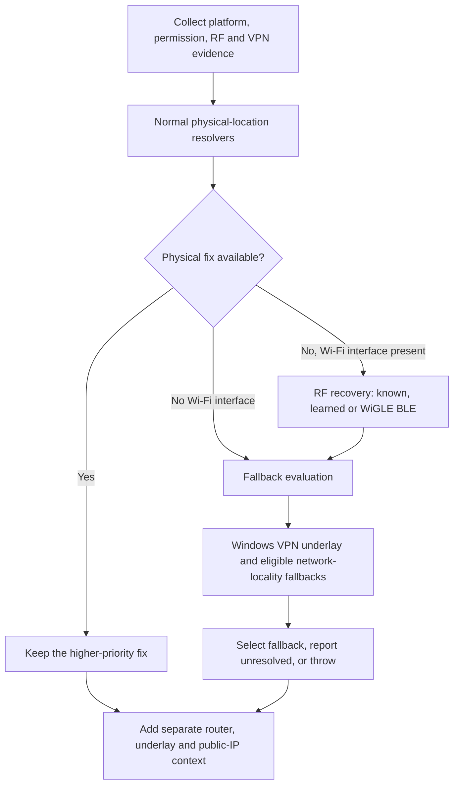

# Get-DeviceCoords

Get-DeviceCoords combines device sensors, nearby Wi-Fi and Bluetooth, operating-system location services, and network-path evidence to report the best available endpoint location. It also explains how that result differs from the carrier, ISP, or VPN exit seen on the Internet.

**Current PowerShell version: [v3.67.1](Get-DeviceCoords-v3.67.1.ps1).** This replaces v3.65.3 as the current script. It hardens learned-BLE recovery with anchor maturity, weighted scoring, and cache migration. The supplied development notes report successful migration and trustworthy-location seed tests; final v3.67.1 Location-off hardware validation is still pending. The earlier v3.67 learned-BLE recovery was demonstrated successfully.

## Contents

- [Quick start](#quick-start)
- [Platforms and requirements](#platforms-and-requirements)
- [Resolver architecture](#resolver-architecture)
- [Known Wi-Fi and Bluetooth maps](#known-wi-fi-and-bluetooth-maps)
- [Optional Google and WiGLE services](#optional-google-and-wigle-services)
- [Windows Location and consent](#windows-location-and-consent)
- [VPN detection and physical underlay](#vpn-detection-and-physical-underlay)
- [RF Location Fusion](#rf-location-fusion)
- [Learned BLE anchors](#learned-ble-anchors)
- [Router and upstream-path diagnostics](#router-and-upstream-path-diagnostics)
- [Output reference](#output-reference)
- [Winnipeg, Toronto, and Calgary example](#winnipeg-toronto-and-calgary-example)
- [PowerShell parameters](#powershell-parameters)
- [Caches and retained data](#caches-and-retained-data)
- [Network and privacy behavior](#network-and-privacy-behavior)
- [Troubleshooting](#troubleshooting)
- [Bash companion and legacy script](#bash-companion-and-legacy-script)
- [Validation and version status](#validation-and-version-status)

## Quick start

From PowerShell in the repository directory:

```powershell
./Get-DeviceCoords-v3.67.1.ps1 | Format-List *
```

From a Linux/macOS shell with PowerShell installed:

```bash
pwsh -NoProfile -File ./Get-DeviceCoords-v3.67.1.ps1
```

The script returns a single object. Keep the object for automation; apply formatting only when displaying it:

```powershell
$location = ./Get-DeviceCoords-v3.67.1.ps1
$location | Select-Object Method, Confidence, Latitude, Longitude, VpnResistant, LocalCity
$location | ConvertTo-Json -Depth 6 | Set-Content -Path ./device-location.json
```

Request an explicit BLE scan, diagnostics, or expanded evidence:

```powershell
./Get-DeviceCoords-v3.67.1.ps1 -BluetoothScanSeconds 10 | Format-List *
./Get-DeviceCoords-v3.67.1.ps1 -Verbose -FullEvidence | Format-List *
Get-Help ./Get-DeviceCoords-v3.67.1.ps1 -Full
```

Normal output caps Wi-Fi evidence at 20 rows and Bluetooth at 15. `-FullEvidence` removes those display limits; resolvers always use the full collected set. Evidence properties can contain formatted text tables rather than nested arrays.

Read `Method`, `Confidence`, `Detail`, and `Notes` before treating selected coordinates as a physical fix: the result can be a network-location heuristic. With an established Windows endpoint VPN and no defensible alternative, the script returns `PhysicalLocationUnresolved` with null coordinates. Without an eligible resolver or fallback, it throws an error.

## Platforms and requirements

| File | Platforms | Role |
| --- | --- | --- |
| [Get-DeviceCoords-v3.67.1.ps1](Get-DeviceCoords-v3.67.1.ps1) | Windows, Linux, macOS | Current workflow. PowerShell 7 recommended; Windows PowerShell 5.1 compatibility retained. |
| [get-device-coords-v2.6.sh](get-device-coords-v2.6.sh) | Linux, macOS | Standalone Bash 3.2+ companion aligned with the v3.62 feature contract. |
| [Get-DeviceCoords-v1.0.ps1](Get-DeviceCoords-v1.0.ps1) | Windows | Legacy Windows PowerShell 5.1 registry/`GeoCoordinateWatcher` workflow. |

The following matrix describes **PowerShell v3.67.1**. Hardware, services, permissions, and optional tools determine availability. The script does not install these dependencies.

| Capability | Windows | Linux | macOS |
| --- | --- | --- | --- |
| Wi-Fi discovery | Native WLAN refresh/BSS data and `netsh`; current-association fallback where accessible | NetworkManager `nmcli`, with a 20-second forced-rescan timeout | CoreWLAN through built-in `osascript`/JXA; legacy `airport` fallback where available |
| Native location | WinRT Windows Location and `GeoCoordinateWatcher` compatibility paths | GeoClue `where-am-i` helper when installed and usable | Core Location through `osascript`/JXA |
| Verified satellite fix | GNSS hardware evidence plus `PositionSource=Satellite` | No dedicated GNSS collector | No dedicated GNSS collector |
| BLE advertisements | Current-host WinRT, then automatic Windows PowerShell 5.1/in-memory C# fallback | BlueZ `bluetoothctl` | Not implemented in this PowerShell collector; see Bash companion |
| Known Wi-Fi map, Google/WiGLE Wi-Fi, public-IP evidence | Supported | Supported | Supported |
| Learned BLE recovery | Available with eligible observations and a seeded cache | Available with eligible BlueZ observations and a seeded cache | No BLE collector in this PowerShell version |
| Established-socket underlay, source-bound ICMP/STUN, IPv6/DNS edge probes | Windows-specific | Not implemented | Not implemented |

Linux BLE reports `UnavailableNoScanner`, `UnavailableNoAdapter`, `PoweredOff`, `AccessDenied`, `Failed`, or `Success`. Its engine is `BlueZBluetoothctl` when used. It inspects the controller before scanning and does not power on an unavailable adapter. A successful scan may contain zero advertisers.

The Windows BLE compatibility path is expected when modern .NET cannot project the WinRT watcher type. A successful fallback is reported as a successful scan; primary-engine diagnostics remain available with `-Verbose`.

## Resolver architecture

The script keeps three different observations conceptually separate:

| Layer | What it describes | Typical evidence |
| --- | --- | --- |
| Physical endpoint location | Where the device or its learned RF neighbourhood is located | Satellite fix, known anchors, Wi-Fi geolocation, native location, learned BLE cluster |
| Physical-underlay / carrier egress | Where the ISP or carrier carries traffic out to the Internet | Underlay route, public ICMP hop, STUN NAT address, IPv6 prefix, DNS/ECS |
| VPN egress | Where the tunnel exits | Public IP observed while the VPN is active |

Carrier backhaul and VPN routing can put all three in different cities. `VpnResistant=True` means evidence is independent of the VPN exit; it does not guarantee physical precision. An underlay IP can be VPN-resistant and still represent a distant carrier point of presence.



### Normal physical-location priority

1. **`WindowsGPS`** — verified satellite/GNSS fix. A GPS-named device alone is insufficient; the position source must be `Satellite`.
2. **`KnownWiFi`** — visible BSSIDs matched to a local site CSV.
3. **`KnownBluetooth`** — explicitly configured BLE anchor map, when a scan produces a match.
4. **`GoogleWiFi`** — nearby Wi-Fi geolocation with `considerIp=false`.
5. **`WiGLEWiFi`** — exact-BSSID lookup with persistent caching and a live-query budget.
6. **Native OS location** — `WindowsLocation`, `MacCoreLocation`, or `LinuxGeoClue`. A Windows native attempt can also discover a satellite source.
7. **`WindowsLocationOG`** — revised embedded `GeoCoordinateWatcher` result, selected after higher-priority methods fail.

Collection order differs from selection priority: the Windows OG comparison runs early when system location permits it, but remains a lower-priority candidate. Source-specific maps preserve provenance when a candidate exists.

`-TimeoutSeconds` controls native-location waits, not total runtime. Compatibility probes, scans, API calls, and traces have their own waits.

### Fallbacks

An unresolved Wi-Fi-capable endpoint can enter RF edge recovery. Windows VPN-underlay tracing is also attempted whenever an endpoint VPN is established, even if a stronger physical fix already succeeded.

If no stronger fix exists, the script may select `WindowsVpnUnderlayTrace`, then eligible IPv6/DNS locality, then source-bound underlay IPv4 egress. These are **network-location heuristics**, even though their coordinates occupy the selected result fields. IPv6/DNS methods require RF edge mode; STUN requires an established Windows VPN over a proven Wi-Fi underlay.

`PublicIP` is the final fallback when available, except that an **established Windows endpoint VPN disqualifies VPN public-IP coordinates from selection**. In that Windows case, `PublicIpRole=VpnEgressOnly`; unresolved physical location stays explicit. Linux/macOS retain their existing public-IP fallback behavior, so inspect their VPN indicators and selected method carefully. An installed VPN adapter alone is weaker evidence than an established tunnel.

## Known Wi-Fi and Bluetooth maps

Wi-Fi observations are normalized, deduplicated, and signal-sorted. The script checks for a Wi-Fi interface before scanning; no interface produces `SkippedNoWifiInterface`. Windows may recover only the current associated AP when surrounding enumeration fails. That is association evidence, not a nearby RF survey.

### Wi-Fi site CSV

Example `sites.csv`:

```csv
BSSID,Latitude,Longitude,Site,AccuracyMeters
00:11:22:33:44:50,49.8951,-97.1384,Winnipeg Office,50
00:11:22:33:44:51,49.8951,-97.1384,Winnipeg Office,50
```

```powershell
./Get-DeviceCoords-v3.67.1.ps1 -WifiMapPath ./sites.csv
```

Replace example identifiers and coordinates with your inventory. The resolver chooses the site with the most visible mapped APs, then its strongest mapped BSSID. A positive CSV accuracy is used when supplied; otherwise it defaults to 50 m. This is a configured estimate, not measured GPS accuracy.

### Bluetooth anchor JSON

Example `bluetooth-anchors.json`. Include matching fields with null values for unused alternatives:

```json
[
  {
    "Name": "Office beacon",
    "Address": "00:11:22:33:44:55",
    "ServiceUuid": null,
    "ManufacturerId": null,
    "Latitude": 49.8951,
    "Longitude": -97.1384,
    "Site": "Winnipeg Office"
  }
]
```

```powershell
./Get-DeviceCoords-v3.67.1.ps1 -BluetoothMapPath ./bluetooth-anchors.json -BluetoothScanSeconds 10
```

Matching supports address, service UUID, or manufacturer ID plus exact advertised name, in that order. The strongest matching advertiser supplies the anchor. `KnownBluetooth` reports no numeric accuracy. This manually maintained map is separate from the automatically learned hashed cache.

A Bluetooth map enables an internal four-second scan if no duration is configured. Explicit Bluetooth controls keep status/detail/evidence visible for failed or empty scans. `-SkipBluetooth` takes precedence.

## Optional Google and WiGLE services

Google and WiGLE are optional. Local maps, native location, learned-cache matching, and network evidence do not require these credentials. Parameters override the corresponding environment variables.

### Google

```powershell
$env:GOOGLE_GEO_API_KEY = '<key>'
./Get-DeviceCoords-v3.67.1.ps1
# Alternatively: -GoogleGeolocationApiKey '<key>'
```

Google needs at least two usable, universally administered BSSIDs and receives up to the strongest 30. Invalid, broadcast, multicast/group, locally administered, and reserved `00:00:5E` addresses are excluded. A visible hotspot is not necessarily Google-usable.

The request includes BSSIDs and available signal/channel data, with **`considerIp=false`** to prevent substituting VPN/public-IP location. No key means no Google request and no Google-specific output section. HTTP 403, 404, and other outcomes appear in status/notes; they do not silently become an IP-based Google fix.

### WiGLE

```powershell
$env:WIGLE_API_NAME = '<api-name>'
$env:WIGLE_API_TOKEN = '<api-token>'
./Get-DeviceCoords-v3.67.1.ps1 -MaxWigleLookupsPerRun 8
# Alternatively: -WigleApiName '<api-name>' -WigleApiToken '<api-token>'
```

Both credentials are needed. WiGLE Wi-Fi queries exact BSSIDs, uses fresh cached results before live requests, and prioritizes the current usable associated BSSID. Positive cache entries are fresh for 180 days; misses for 14 days. The default live Wi-Fi budget is eight. Authentication, forbidden, terminal-error, and rate-limit conditions stop further Wi-Fi queries as appropriate. Counters, candidate order, HTTP details, and cache hits explain the outcome.

WiGLE BLE is an edge-only recovery mechanism with a separate default budget of six. Only public BLE addresses with usable RSSI qualify; random/private addresses are excluded. At least two independent matches must form a geographic cluster using a two-kilometre clustering radius. One crowdsourced BLE observation cannot resolve location. `WiGLEBluetoothCluster` has `Medium` confidence and a neighbourhood estimate of at least 500 m.

WiGLE is query-only: no observation upload or donation/commercial-use flag is enabled. Queries still disclose the requested BSSID or eligible BLE address to WiGLE.

## Windows Location and consent

Service availability, device-wide state, policy, and user consent are separate signals:

| Condition | Effective state / behavior |
| --- | --- |
| Location disabled by policy (`DisableLocation`) | `BlockedByPolicy`; no temporary consent attempt |
| Device/global Location denied | `BlockedBySystemGlobal`; native location and programmatic BSSID collection skipped |
| Global Location enabled, user/DesktopApps consent incomplete | `UserConsentRequired`; temporary user-scope consent may be attempted |
| Global Location and both consent scopes allowed | `Allowed`; providers may still time out or return no fix |
| Geolocation service (`lfsvc`) unavailable | Reported separately; consent alone cannot make it available |

Device-wide consent is read from `HKLM:\SOFTWARE\Microsoft\Windows\CurrentVersion\CapabilityAccessManager\ConsentStore\location`. Modern Windows can block WLAN BSSID enumeration when global Location is off. Per-user/DesktopApps consent cannot override global/policy blocks; the script respects them.

When permitted, the current workflow snapshots relevant loaded interactive-user hive consent values, temporarily sets them to Allow, and attempts restoration in cleanup. Interactive-user discovery supports service/remediation execution contexts; registry access and restoration depend on account permissions.

**`-NoTemporaryLocationConsent` limitation:** this switch suppresses consent retries in the main workflow. In the supplied version, the early embedded OG comparison and its consent wrapper are not gated by it. It does not guarantee zero user-consent writes. `WindowsLocationTemporaryConsentUsed` describes main-workflow tracked changes, not a complete audit of the embedded OG path. Global/policy blocks prevent both paths from attempting consent changes.

## VPN detection and physical underlay

Detected adapters and established tunnel indicators are separate. Windows can enrich OpenVPN, WireGuard, and built-in VPN identities with available endpoint, interface, and route evidence. Linux/macOS use platform-specific adapter/route indicators without the newer Windows underlay recovery.

### Established socket binding

A full-tunnel VPN changes the route table. A new `Find-NetRoute` lookup may point into the tunnel even though its existing connection is carried over physical Wi-Fi.

For a usable established VPN socket, the Windows assessment:

1. Finds the VPN remote endpoint and socket local address.
2. Maps that local address to a non-VPN interface through `Get-NetIPAddress`.
3. Resolves its next hop.
4. Treats the established local binding as the strongest physical-transport evidence.
5. Falls back to `Find-NetRoute` when no usable socket binding exists, rejecting a route that still selects a known VPN interface.

This is particularly useful for TCP OpenVPN. UDP VPNs and other clients may expose less binding evidence and require the route fallback. An unresolved assessment does not prove the physical interface is absent.

```text
WindowsVpnUnderlayStatus        : ResolvedFromEstablishedSocket
WindowsVpnUnderlayBindingSource : EstablishedVpnSocketLocalAddress
WindowsVpnUnderlayTransport     : WiFi
```

`ResolvedFromEstablishedSocket` can prove the interface without a geolocatable public hop. Underlay collection runs even when Windows Location already resolved physical coordinates; it does not replace a stronger fix.

### Source-bound ICMP and carrier NAT

Windows uses `IcmpSendEcho2Ex` to trace from the proven physical IPv4 source toward the VPN server, with a bounded eight-hop trace. It does not change routes or disconnect the VPN. Route-based `tracert` is used only with route-based discovery, not substituted for a proven socket-bound trace.

Hop scopes distinguish RFC1918, `100.64.0.0/10` CGNAT, public addresses, and the VPN endpoint. An observed `RFC1918 -> CGNAT` path can establish `WindowsVpnUnderlayUpstreamClass=CarrierNAT` without a public hop. Public-hop geography remains carrier/ISP path context and may identify a distant network POP.

Established endpoint VPN + proven Wi-Fi underlay + immediate carrier-NAT signature produces:

```text
ConnectionScenario         : VPNover5G
ConnectionScenarioClass    : VPNoverCellularHotspot
CellularGenerationEvidence : Cellular hotspot strongly indicated; LTE versus 5G radio generation is not directly observable from the Windows endpoint
```

`VPNover5G` is an operational label, not proof of the phone's radio generation. Other scenarios include `VPNoverWiFi`, `VPN`, and `WiFi`; the non-VPN Wi-Fi classification is based on interface presence.

## RF Location Fusion

RF Location Fusion is **edge recovery**. Normal GPS, known-anchor, Wi-Fi, and native-location methods retain priority. Edge mode starts when physical location remains unresolved and a Wi-Fi interface is present, including non-VPN cases.

Triggers include `WindowsLocationAndBssidBlocked`, `EndpointVpnPhysicalLocationUnresolved`, `WifiPresentNoRfCoordinates`, and `WifiResolversExhausted`.

The BLE stage reuses collected devices where possible, or automatically starts a five-second scan if no devices were collected and `-SkipBluetooth` is absent. It tries a configured known-Bluetooth map, the locally learned cache, and optional WiGLE BLE clustering. A successful normal fix does not trigger that automatic scan.

**Normal BLE collection is opt-in; unresolved edge recovery can automatically scan by default.** `-SkipBluetooth` prevents BLE collection. `-DisableRfFusion` disables recovery, while explicitly requested normal BLE scanning can still run.

### Additional Windows locality probes

If RF recovery has not resolved location, Windows can inspect the proven physical Wi-Fi underlay, or the physical default-gateway Wi-Fi interface in a non-VPN edge case:

| Evidence | Operation | Selection / limitation |
| --- | --- | --- |
| Global IPv6 | Inspect physical-interface global addresses and an early global IPv6 trace hop | `UnderlayIPv6`, `Low`, nominal 20 km estimate. No global address yields `NoGlobalIpv6`. |
| Local DNS / EDNS Client Subnet (ECS) | Query underlay-local diagnostic TXT evidence for client subnet and resolver address | ECS can select `UnderlayDnsEcs`, `Low`, nominal 25 km estimate; resolver city alone is supporting context. |
| IPv6 + ECS agreement | Compare geolocated city/region values | `UnderlayNetworkConsensus`, `Medium`, nominal 15 km estimate; still network locality. |
| Source-bound IPv4 STUN | Recover physical Wi-Fi NAT egress with a Windows endpoint VPN established | `UnderlayEgressIP`, `Low`, nominal 25 km estimate if selected; carrier backhaul may be much farther away. |

These accuracy values are heuristics, not measured bounds on physical error. Agreement between network sources does not turn them into GPS.

DNS diagnostics use local/private underlay-configured resolvers or the gateway, rather than trusting a public resolver that might be reached through the VPN. The diagnostic name is `o-o.myaddr.l.google.com`. ECS can be absent, and a resolver can be geographically displaced just like carrier egress.

### Source-bound STUN

STUN binds the physical local IPv4 address and Windows interface (`IP_UNICAST_IF` plus `Socket.Bind`). It tries `stun.cloudflare.com:3478` and `stun.l.google.com:19302` over UDP, reads the mapped address, and reports stage, server, interface pinning, local socket, and error.

This deliberately sends a probe through the physical underlay outside the VPN and can reveal the ISP/carrier-facing public IP. Use `-DisableUnderlayStunProbe` to disable it. A result equal to the VPN-visible public IP is marked `MatchedVpnEgress` and rejected as independent evidence.

STUN runs in the unresolved Windows VPN-over-Wi-Fi recovery case, or as supporting context after an IPv6/DNS network heuristic. A stronger physical or learned-RF fix avoids it. A successful hotspot probe uses `UnderlayPublicIpRole=CarrierEgress`; other Wi-Fi underlays use `PhysicalUnderlayEgress`.

`-DisableRfFusion` suppresses RF recovery and added IPv6/DNS/STUN recovery probes. It does not suppress baseline Windows VPN-underlay assessment, router discovery, or ordinary public-IP lookup. `-SkipPublicIpLookup` skips ordinary public-IP lookup/comparison; it is not a network-off switch and does not disable STUN or other IP enrichment.

## Learned BLE anchors

The local learned cache recognizes a previously observed RF neighbourhood without needing Google, WiGLE, carrier egress, or VPN egress to supply the recovered coordinate.

### Learning and conflicts

With BLE observations available, learning requires an allowlisted physical method and reported accuracy of at most 5,000 m. The allowlist covers GPS, known anchors, Wi-Fi providers, and native/OG location; methods without numeric accuracy do not pass the accuracy check. IP/network and learned-cluster results do not seed learning.

An eligible advertiser has a public normalized BLE address, RSSI of at least -100 dBm, and at least two observations when `SeenCount` exists. Persistence uses SHA-256 hashes of normalized `BLE:<address>` identities, with coordinates, session/conflict counts, and UTC timestamps. Raw BLE MAC addresses are not written to this learned cache.

Observations within five kilometres update the running coordinate average and increment the session count. A farther observation marks the entry `Conflicted`, excluding it from recovery. Sessions are learning runs; there is no documented minimum time interval between them.

### v3.67.1 maturity and score

| Trustworthy learning sessions | Maturity | RF weight |
| --- | --- | --- |
| 1 | `Candidate` | 1 |
| 2 | `Probable` | 2 |
| 3 or more | `Trusted` | 3 |
| Any location conflict | `Conflicted` | Excluded |

Recovery deduplicates matched public identities and computes a maturity-weighted centroid. **All gates must pass:**

- RF score **at least 7**.
- **At least two Trusted** matched anchors.
- Maximum distance from the weighted centroid **at most 2 km**.

Two Trusted anchors score six and cannot resolve alone. Two Trusted plus one Candidate score seven and pass the score/trust gate if clustered. Three Trusted score nine. Candidate/Probable entries remain evidence without being authoritative by themselves.

Success returns `LearnedBluetoothRfCluster`, `Medium` confidence, and `VpnResistant=True`. Accuracy is estimated as at least 250 m or the cluster radius in metres, whichever is larger. Rejections include `CacheEmpty`, `NoMatches`, `InsufficientMaturity`, and `MatchesNotClustered`.

**Observed empty-match limitation:** an isolated check on PowerShell 7.4.13 found that an empty match set throws `The property 'Sum' cannot be found on this object` under StrictMode, before the intended `CacheEmpty`/`NoMatches` return. An unresolved edge run with BLE observations but no matching learned anchors can therefore terminate instead of continuing to later fallbacks. `-DisableRfAnchorLearning` skips this resolver and learning while leaving other eligible recovery methods available. The uploaded script is unchanged; this issue needs a separate code fix and regression check.

### Migration, evidence age, and controls

v3.67.1 uses `rf-anchor-cache-v2.json`. If v2 is absent, it reads v1, normalizes entries, and preserves available session counts; missing counts start at Candidate. An eligible learning update writes v2. The legacy v1 file is left untouched for rollback.

`RfPhysicalEvidenceAge` and `RfAnchorLastConfirmedUtc` describe the most recent trustworthy observation among matched Trusted anchors. They are telemetry, not an enforced expiry gate. The hashes are deterministic and unsalted: treat this location-linked cache as sensitive rather than anonymous.

`-DisableRfAnchorLearning` disables **both learning and learned-cache recovery**. It does not disable manual Bluetooth maps, scanning, or optional WiGLE BLE recovery.

```powershell
# Repeat on trustworthy-location observations at the site to mature anchors.
$seed = ./Get-DeviceCoords-v3.67.1.ps1 -BluetoothScanSeconds 10
$seed | Select-Object Method, AccuracyMeters, RfAnchorLearningStatus,
    RfLearnedAnchorCandidateCount, RfLearnedAnchorProbableCount,
    RfLearnedAnchorTrustedCount, RfLearnedAnchorCacheCount

# Later, in an unresolved edge case, inspect the matched neighbourhood.
$recovery = ./Get-DeviceCoords-v3.67.1.ps1 -BluetoothScanSeconds 10
$recovery | Select-Object Method, Confidence, LocalCity, RfLearnedAnchorStatus,
    RfLearnedAnchorScore, RfLearnedAnchorRequiredScore,
    RfLearnedAnchorTrustedCount, RfLearnedAnchorClusterRadiusKm,
    RfAnchorLastConfirmedUtc, RfPhysicalEvidenceAge
```

Seed counts describe the cache after learning; edge counts describe matched anchors. A large Trusted cache does not guarantee enough of those anchors are currently visible.

## Router and upstream-path diagnostics

Independent of endpoint geolocation, router discovery finds a physical/default LAN gateway and gathers available local address, interface type, gateway MAC/vendor, DHCP server, and DNS suffix.

It can use:

- **UPnP IGD** for device/model/manufacturer information and external IPv4.
- **NAT-PMP** for external IPv4 when UPnP did not provide it.
- **PCP ANNOUNCE** for support detection.
- A short unauthenticated **gateway HTTP/TLS fingerprint** when UPnP identity is incomplete.
- Short traces and public-hop **ISP/ASN geolocation** for upstream interpretation.

These are discovery/status requests. They do not create port mappings, configure the router, change routes, or authenticate to its administration interface. Manufacturer/model/OUI hints are normalized into resolved hardware identity/platform with separate confidence and basis. A brand/OUI hint alone does not prove exact hardware or firmware.

`RouterVpnSuspected` is multi-state: `True`, `False`, `Possible`, `Indeterminate`, or `Unknown`, with separate confidence and evidence. A matching public WAN/egress supports direct routing; provider/ASN mismatch supports upstream VPN/proxy inference. Private/CGNAT WANs, missing responses, multi-WAN, and endpoint VPNs complicate attribution. A mismatch alone is not proof of a router VPN.

`TraceGeoSource=RouterPath` identifies ordinary path evidence. When an endpoint VPN suppresses that trace and Windows underlay evidence exists, `TraceGeoSource=WindowsVpnUnderlay` exposes the separate path without attributing it to a router VPN.

## Output reference

These groups cover the main operator-facing properties. Google/WiGLE sections require configured credentials; Bluetooth requires requested/edge collection; GPS fields require detected/discovered satellite evidence. Windows Location fields are Windows-only, and Windows VPN-underlay/STUN fields require an established Windows endpoint VPN. `WifiEvidence` is always the final property.

### Selected location and provenance

| Fields | Meaning |
| --- | --- |
| `ComputerName`, `DeviceType`, `TimestampUtc` | Endpoint identity/classification and UTC collection time. |
| `Method`, `Confidence`, `Latitude`, `Longitude`, `AccuracyMeters`, `Site` | Selected resolver, estimate, and mapped site. Unknown accuracy is `NotReported`. |
| `VpnResistant`, `Detail`, `Notes` | VPN independence, concise explanation, and qualifications. |
| `LocalCity`, `LocalProvince`, `LocalCountry` | Locality derived from the selected coordinate where available; not an independent physical measurement. |
| `LocalCitySource`, `LocalCityMatchType`, `LocalCityInsideRange`, `LocalCityCenterDistanceKm`, `LocalCityCenter`, `LocalCityLatRange`, `LocalCityLongRange` | City-label provenance, coarse operational envelope, and distance. |
| `MapUri`, `SelectedMapUri` | Map for the selected coordinate, including a network heuristic. |
| `GpsMapUri`, `KnownWifiMapUri`, `BluetoothAnchorMapUri`, `GoogleWifiMapUri`, `WigleMapUri`, `WigleBluetoothMapUri`, `NativeLocationMapUri`, `OgLocationMapUri`, `PublicIpMapUri`, `RouterWanMapUri`, `UnderlayEgressMapUri` | Separate source maps; unavailable candidates are generally `NotAvailable`. |
| `og_devcoordscript_says`, `OG_and_NewG_gap` | OG map and a directions link comparing OG/selected coordinates when both exist. |

Canadian city bucketing uses coarse embedded envelopes, then the nearest embedded centre within 200 km. It is not a global reverse geocoder or municipal-boundary test. An underlay trace preserves its actual IP-geolocation city rather than silently replacing it with the nearest major city.

Confidence is method-specific: GPS/known maps are `High`; learned and WiGLE BLE clusters, OG, underlay trace, and network consensus are `Medium`; IP/single-source underlay network fallbacks are `Low`; unresolved is `None`. For other methods, accuracy ≤250 m is `High`, ≤5 km is `Medium`, larger is `Low`, and missing accuracy is `Medium`.

### Collectors and permissions

| Fields | Meaning |
| --- | --- |
| `WifiScanStatus`, `CurrentWifiSsid`, `CurrentWifiBssid`, `CurrentWifiSignalPct`, `CurrentWifiChannel`, `WifiEvidence` | Scan outcome, available current association, and AP table. |
| `GoogleWifiResolverStatus`, `StrongestGoogleUsable*` | Google outcome and strongest eligible AP. |
| `WigleWifiResolverStatus`, `WigleCredentialSource`, `WigleLiveQueriesUsed`, `WigleLookupBudget`, `WigleCacheHits`, `WigleCandidateOrder`, `WigleCurrentBssid*`, `WigleLastHttpStatus`, `WigleLastError*`, `WigleTerminalFailure*`, `WigleRateLimit*` | WiGLE ordering, query budget, caching, HTTP/terminal conditions, and rate limiting. |
| `BluetoothScanStatus`, `BluetoothScanEngine`, `BluetoothScanDetail`, `BluetoothDeviceCount`, `BluetoothEvidence` | BLE outcome, engine, count, and advertisement table. |
| `BluetoothAnchorCount`, `StrongestBluetooth*`, `BluetoothLocationMatch`, `BluetoothLocationDistanceKm` | Strongest advertiser and manual-anchor corroboration. |
| `GpsHardwareDetected`, `GpsHardware`, `GpsFixStatus`, `GpsPositionSource`, `GpsLatitude`, `GpsLongitude`, `GpsAccuracyMeters`, `GpsAltitudeMeters`, `GpsHorizontalDop`, `GpsPositionDop` | Conditional GNSS hardware/fix telemetry. |
| `WindowsLocationServiceState`, `WindowsNativeLocationStatus` | Geolocation service and provider outcome. |
| `WindowsLocationGlobalState`, `WindowsLocationPolicyState`, `WindowsLocationUserConsent`, `WindowsLocationDesktopAppsConsent`, `WindowsLocationEffectiveState`, `WindowsLocationTemporaryConsentUsed` | Access scopes and main-workflow tracked temporary consent. |

### VPN, router, and underlay

| Fields | Meaning |
| --- | --- |
| `VpnAdapterDetected`, `EstablishedVpnTunnel` | Detected/established descriptions or `None`, not plain booleans. |
| `PublicIp`, `PublicIpCity`, `PublicIpRegion`, `PublicIpCountry`, `PublicIpIsp`, `PublicIpRole` | Ordinary Internet egress; `PublicIpRole=VpnEgressOnly` for an established Windows endpoint VPN. |
| `PhysicalVsPublicIpDistanceKm`, `VpnOrRemoteEgressLikely` | Separation and remote-egress indicator. Established tunnel or separation ≥100 km flags likely remote egress. |
| `ActiveInterface`, `ActiveInterfaceType`, `LocalIPv4`, `DefaultGateway`, `GatewayMac`, `GatewayVendor`, `DhcpServer`, `ConnectionDnsSuffix` | Local-network context. |
| `RouterFriendlyName`, `RouterManufacturer*`, `RouterPlatform`, `RouterIdentityConfidence`, `RouterIdentityBasis`, `RouterModel`, `RouterWebHint`, `RouterTlsSubject` | Router hardware/platform hints and identity confidence. |
| `RouterWanIp`, `RouterWanIsp`, `RouterWanGeo`, `RouterVpnSuspected`, `RouterVpnConfidence`, `RouterVpnEvidence`, `TraceGeoSource`, `TraceGeo` | WAN geography, upstream assessment, and selected path trace. |
| `WindowsVpnUnderlayStatus`, `WindowsVpnUnderlayEndpoint`, `WindowsVpnUnderlayEndpointSource`, `WindowsVpnUnderlayBindingSource` | Resolution state and endpoint/binding provenance. |
| `WindowsVpnUnderlayLocalIp`, `WindowsVpnUnderlayInterface`, `WindowsVpnUnderlayNextHop`, `WindowsVpnUnderlayTransport`, `WindowsVpnUnderlayTraceMethod`, `WindowsVpnUnderlayTrace` | Bound physical interface and trace. |
| `WindowsVpnUnderlayFirstPublicHop`, `WindowsVpnUnderlayGeoCity`, `WindowsVpnUnderlayGeoRegion`, `WindowsVpnUnderlayGeoCountry`, `WindowsVpnUnderlayNearestMajorCity`, `WindowsVpnUnderlayNearestMajorCityDistanceKm` | Public-hop geography and separate major-city context. |
| `WindowsVpnUnderlayCarrierNatDetected`, `WindowsVpnUnderlayCarrierNatHopCount`, `WindowsVpnUnderlayPathClass`, `WindowsVpnUnderlayUpstreamClass`, `WindowsVpnUnderlayRole`, `WindowsVpnUnderlayGeoMeaning` | Carrier NAT classification and supporting/fallback interpretation. |
| `ConnectionScenario`, `ConnectionScenarioClass`, `ConnectionScenarioConfidence`, `ConnectionScenarioBasis`, `CellularGenerationEvidence` | Topology and explicit LTE/5G visibility limit. |

### RF recovery and edge-locality evidence

| Fields | Meaning |
| --- | --- |
| `RfLocationMode`, `RfLocationTrigger`, `RfFusionStatus`, `RfFusionMethod` | Normal/edge mode, reason, outcome, and recovery method. |
| `RfFusionBleCandidateCount`, `RfFusionBleMatchedCount`, `RfFusionBleClusterCount`, `RfFusionBleClusterRadiusKm`, `RfFusionWigleBluetoothStatus`, `RfFusionWigleBluetoothQueries` | WiGLE BLE candidates, matches, cluster, and budget use. |
| `RfLearnedAnchorStatus`, `RfLearnedAnchorMatchedCount`, `RfLearnedAnchorCandidateCount`, `RfLearnedAnchorProbableCount`, `RfLearnedAnchorTrustedCount` | Learned-cache outcome and maturity counts. |
| `RfLearnedAnchorScore`, `RfLearnedAnchorRequiredScore`, `RfLearnedAnchorRequiredTrusted`, `RfLearnedAnchorClusterRadiusKm`, `RfLearnedAnchorEvidence` | Weighted score, gates, spread, and explanation. |
| `RfPhysicalEvidenceAge`, `RfAnchorLastConfirmedUtc`, `RfLearnedAnchorCacheCount`, `RfAnchorCacheVersion`, `RfAnchorCacheMigratedFromLegacy`, `RfAnchorLearningStatus`, `RfAnchorCachePath` | Trustworthy evidence age and cache/learning diagnostics. |
| `UnderlayIpv6Status`, `UnderlayIpv6Address`, `UnderlayIpv6PrefixLength`, `UnderlayIpv6GeoCity`, `UnderlayIpv6GeoRegion`, `UnderlayIpv6FirstGlobalHop`, `UnderlayIpv6FirstGlobalHopCity`, `UnderlayIpv6TraceStatus`, `UnderlayIpv6Trace` | Physical-interface IPv6 and early-hop locality. |
| `UnderlayDnsLocalityStatus`, `UnderlayDnsServers`, `UnderlayDnsEcsSubnet`, `UnderlayDnsEcsCity`, `UnderlayDnsEcsRegion`, `UnderlayDnsResolverPublicIp`, `UnderlayDnsResolverCity`, `UnderlayDnsTxtEvidence` | ECS/resolver evidence, including non-resolving results. |
| `UnderlayPublicIpProbeStatus`, `UnderlayPublicIpProbeStage`, `UnderlayPublicIpProbeServer`, `UnderlayPublicIpProbeInterfacePinApplied`, `UnderlayPublicIpProbeInterfacePinMethod`, `UnderlayPublicIpProbeLocalSocket`, `UnderlayPublicIpProbeError` | STUN execution and binding diagnostics. |
| `UnderlayPublicIp`, `UnderlayPublicIpRole`, `UnderlayPublicIpCity`, `UnderlayPublicIpRegion`, `UnderlayPublicIpIsp` | Physical-underlay NAT egress and network-location role. |

## Winnipeg, Toronto, and Calgary example

The supplied development notes describe a laptop physically in Winnipeg, connected by Wi-Fi to a nearby phone hotspot with OpenVPN active. Across reported runs, three layers were separated:

| Layer | Observed city | Interpretation |
| --- | --- | --- |
| Windows Location / learned local BLE neighbourhood | Winnipeg, MB | Physical location evidence |
| Source-bound STUN, TELUS public carrier NAT | Toronto, ON | Carrier egress/backhaul |
| VPN-visible public IP | Calgary, AB | VPN egress |

The OpenVPN established socket identified physical Wi-Fi. ICMP exposed a private gateway followed by CGNAT, without a geolocatable public underlay hop. STUN recovered the carrier NAT address; its Toronto geography did not locate the laptop. IPv6 reported `NoGlobalIpv6`; underlay DNS provided no usable ECS subnet and its resolver also geolocated to Toronto.

In **v3.67**, a trustworthy-location seed learned four BLE anchors. A later Location-off run matched all four and resolved Winnipeg with `LearnedBluetoothRfCluster`, `Medium` confidence, and `VpnResistant=True`, while Windows Location/BSSID enumeration were blocked. Carrier/VPN egress geolocation was unnecessary for that RF recovery.

Conceptual interpretation, rather than a single captured v3.67.1 output:

```text
Physical RF location : Winnipeg, MB
Carrier egress       : Toronto, ON
VPN egress           : Calgary, AB
ConnectionScenario   : VPNover5G
ScenarioClass        : VPNoverCellularHotspot
Physical method      : LearnedBluetoothRfCluster
VPN-resistant        : True
```

**v3.67.1 validation boundary:** migration and repeated trustworthy Winnipeg seed runs reportedly yielded five Trusted anchors in an eight-entry cache. This establishes preparation. The supplied notes contain no final v3.67.1 Location-off run and do not establish final acceptance of the hardened build. Four one-session anchors that worked in v3.67 would not satisfy the new maturity gate by themselves.

## PowerShell parameters

Complete top-level parameter list; common advanced-script controls such as `-Verbose` are also available:

| Parameter | Default / range | Purpose |
| --- | --- | --- |
| `-TimeoutSeconds` | `8`; 2–60 | Native-location wait, not total runtime. |
| `-GoogleGeolocationApiKey` | Unset | Google key; fallback `GOOGLE_GEO_API_KEY`. |
| `-WigleApiName` | Unset | WiGLE name; fallback `WIGLE_API_NAME`. |
| `-WigleApiToken` | Unset | WiGLE token; fallback `WIGLE_API_TOKEN`. |
| `-MaxWigleLookupsPerRun` | `8`; 1–20 | Maximum live WiGLE Wi-Fi lookups. |
| `-MaxWigleBluetoothLookupsPerRun` | `6`; 1–12 | Maximum edge WiGLE BLE lookups. |
| `-RfFusionBluetoothScanSeconds` | `5`; 2–15 | Automatic edge BLE scan duration. |
| `-DisableRfFusion` | Off | Disable edge recovery and added IPv6/DNS/STUN recovery probes; baseline underlay diagnostics remain. |
| `-DisableUnderlayStunProbe` | Off | Disable source/interface-bound underlay STUN. |
| `-DisableRfAnchorLearning` | Off | Disable learning and learned-cache recovery. |
| `-WifiMapPath` | Unset; existing file | Known Wi-Fi CSV. |
| `-BluetoothMapPath` | Unset; existing file | Known BLE JSON; enables scan/status output. |
| `-BluetoothScanSeconds` | Null; 1–30 when set | Explicit normal BLE scan; map-only invocation uses four seconds. |
| `-SkipBluetooth` | Off | Skip normal/edge BLE and show the explicit skip outcome. |
| `-NoTemporaryLocationConsent` | Off | Suppress main-workflow consent changes; see the embedded OG limitation. Windows only. |
| `-SkipPublicIpLookup` | Off | Skip ordinary public-IP lookup/comparison; other networking can still occur. |
| `-IncludeWifiEvidence` | Compatibility switch | Evidence is already included. |
| `-FullEvidence` | Off | Remove normal 20 Wi-Fi / 15 BLE row display caps. |

The stock artifact has no normal Bluetooth scan duration default. A deployment copy can intentionally assign a non-null `BluetoothScanSeconds` default to enable scanning without command-line arguments. The uploaded stock artifact is preserved unchanged here.

## Caches and retained data

| Cache family | Windows | Linux | macOS |
| --- | --- | --- | --- |
| WiGLE Wi-Fi / OUI | `%LOCALAPPDATA%\Get-DeviceCoords\` | `${XDG_CACHE_HOME:-$HOME/.cache}/Get-DeviceCoords/` | `$HOME/Library/Caches/Get-DeviceCoords/` |
| Learned RF | `%LOCALAPPDATA%\Get-DeviceCoords\` | `${XDG_CACHE_HOME:-$HOME/.cache}/get-device-coords/` | `${XDG_CACHE_HOME:-$HOME/.cache}/get-device-coords/` for shared RF helpers; no PowerShell macOS BLE collector |

Windows WiGLE/OUI helpers can fall back to `%USERPROFILE%\AppData\Local`. RF has its own fallback calculation; `RfAnchorCachePath` reports the actual target. Unix directory casing differs between RF and WiGLE/OUI caches.

| Filename | Contents / freshness |
| --- | --- |
| `wigle-bssid-cache.json` | Raw BSSID, match/miss, coordinates, SSID, timestamps; 180-day matches / 14-day misses. |
| `oui-vendor-cache.json` | OUI prefix, vendor, check time; 365-day known / 30-day unknown vendors. |
| `rf-anchor-cache-v2.json` | Hashed BLE identity, coordinates, session/conflict counts, maturity, first/last UTC timestamps; no enforced age expiry. |
| `rf-anchor-cache-v1.json` | Legacy RF cache read when v2 is absent, retained for rollback. |

Deleting caches forces fresh lookup/learning and loses accumulated evidence. Deleting only v2 can cause retained v1 to be read again; account for both RF files when resetting history. Keep caches and location exports out of source control.

## Network and privacy behavior

The script makes active Wi-Fi discovery, local-network status probes, and potentially external requests. Selecting a local anchor does not automatically disable background enrichment.

| Destination / mechanism | When / data involved |
| --- | --- |
| `www.googleapis.com` | Configured Google resolver: BSSIDs and available signal/channel; IP substitution disabled. |
| `api.wigle.net` | Configured exact Wi-Fi or eligible edge BLE query: queried address and API authentication. No observation upload. |
| `api.ipify.org`, `ipwho.is` | Ordinary public-IP discovery/geolocation; `ipwho.is` also enriches other public network addresses. If ipify fails, ordinary lookup can use `ipwho.is/` directly. |
| `api.maclookup.app`, `www.macvendorlookup.com` | Vendor enrichment sends only the OUI prefix, not the complete BSSID/MAC. |
| Cloudflare/Google STUN over UDP | Eligible Windows VPN/Wi-Fi recovery exposes physical-underlay NAT egress. |
| Underlay-local DNS / `o-o.myaddr.l.google.com` | Edge TXT lookup for ECS/resolver locality. |
| Gateway, local multicast, and trace destinations | UPnP, NAT-PMP, PCP, HTTP/TLS fingerprints, bounded path probes. |

BLE collectors do not pair, connect, authenticate, or interrogate GATT. Windows uses passive advertisement watchers. Linux uses BlueZ LE discovery; an already-discoverable controller may issue active scan requests. The script does not change power/discoverability settings and stops its discovery scan afterward.

Learned RF persistence hashes identities, but live output can include raw Wi-Fi/BLE identifiers and names; the separate WiGLE BSSID cache also stores raw identifiers. Machine names, network addresses, coordinates, sites, and map links can be sensitive when shared.

Map URLs are generated, not automatically opened. Opening them sends the coordinate query to the map provider. Request verbosity is suppressed where implemented to avoid echoing credentials; handle environment/parameter credentials and diagnostic exports appropriately.

There is no single offline switch. `-SkipPublicIpLookup`, `-SkipBluetooth`, `-DisableRfFusion`, and leaving optional API credentials unset disable their respective sources, but router/OUI/IP enrichment can still occur. Review the probes for deployments requiring complete network isolation.

## Troubleshooting

| Symptom | Inspect / action |
| --- | --- |
| No Wi-Fi observations | Interface presence and `WifiScanStatus`; Windows global/policy state; Linux NetworkManager/`nmcli`; macOS collecting-process Location permission. |
| Windows Location and BSSIDs blocked | Global/policy blocks are intentional. Per-user consent cannot override them. Seeded BLE may still work when scanning is allowed. |
| Only current AP visible | Association fallback is limited evidence; Google still requires two usable BSSIDs. |
| Google skipped despite visible APs | Check usable BSSID count and key configuration. Random/local addresses are filtered. No key omits the section. |
| Google 403 / 404 | Check API/key permissions for 403; 404 means no Wi-Fi match with IP fallback disabled. |
| WiGLE stops early | Check both credentials, HTTP/rate-limit/terminal status, budget, and cache counters. |
| BLE empty/unavailable | Read status, engine, detail, adapter power, and permissions. Windows 5.1 fallback success is valid. PowerShell macOS BLE is unsupported. |
| RF cache exists but no fix | Check matched Trusted count, score, spread, conflicts, and current visibility. More advertisements in one scan do not equal more trustworthy sessions. |
| RF resolver throws about property `Sum` | Reproduced on PowerShell 7.4.13 for an empty match set. `-DisableRfAnchorLearning` skips the affected learned-cache path; see the limitation above. |
| RF cache does not update | Check writable path, `RfAnchorLearningStatus`, public advertisers, accuracy ≤5 km, and learning control. |
| Old anchors return after reset | v1 is read when v2 is absent; account for both files. |
| VPN IP points to a distant city | Expected egress context; inspect selected method, tunnel evidence, and `PublicIpRole`. |
| No public underlay ICMP hop | CGNAT/filtering may hide public hops; `ResolvedFromEstablishedSocket` can still prove the interface. |
| STUN fails or matches VPN | Inspect stage, server, pinning, and error. VPN/firewall policy may block direct UDP; matching VPN egress is rejected. |
| Underlay city is distant | Carrier backhaul can be displaced. VPN independence does not establish physical locality. |
| `NoGlobalIpv6` / no DNS ECS | Those sources are not guaranteed on this network. |
| `PhysicalLocationUnresolved` | Established Windows VPN disqualifies ordinary public-IP coordinates and no stronger alternative succeeded. Null coordinates mean unresolved. |
| Error on a headless/cloud host | Sensors/services may be absent; public-IP fallback needs HTTPS. Disabling it may leave no location source. |

## Bash companion and legacy script

Bash v2.6 remains available without PowerShell, Python, jq, Homebrew, or automatic package installation:

```bash
bash ./get-device-coords-v2.6.sh
bash ./get-device-coords-v2.6.sh --help
bash ./get-device-coords-v2.6.sh --wifi-map ./sites.csv --quiet
bash ./get-device-coords-v2.6.sh --bluetooth-scan-seconds 10
```

It prints named fields and has its own resolver order/controls. It supports known Wi-Fi/BLE maps, the same Google/WiGLE credential environment variables, native Linux/macOS location, router/path evidence, and public-IP fallback. Linux Wi-Fi has an `iw` fallback; macOS BLE uses native controller evidence plus CoreBluetooth through JXA. Its v3.62 alignment does **not** include the v3.67.1 Windows underlay or learned-anchor hardening contract. See `--help`; Bash options and PowerShell switches are not interchangeable.

The legacy [v1.0](Get-DeviceCoords-v1.0.ps1) requires **Windows PowerShell 5.1 on Windows** and the .NET Framework `System.Device` assembly:

```powershell
.\Get-DeviceCoords-v1.0.ps1
```

It attempts to enable system consent when elevated and user consent in matching hives, does not restore previous values, and uses `GeoCoordinateWatcher` to print coordinates/map output. It has no Google/WiGLE or public-IP fallback. Its standalone consent behavior differs from the current script's wrapped embedded OG comparison. It can exit zero despite runtime errors; inspect errors and output when testing.

## Validation and version status

The uploaded v3.67.1 script is preserved byte for byte. SHA-256:

```text
18B9AD154EEC975E6C96BED717CD8AE5A5630175B94767110EB249FF009AB11A
```

| Version | Main change |
| --- | --- |
| v3.65.3 | Clean baseline with existing platform collectors, BLE compatibility, consent handling, and providers. |
| v3.65.4–v3.65.6 | Always collect Windows VPN underlay, established-socket authority, source-bound ICMP, global/policy Location state, carrier NAT. |
| v3.66 / v3.66.1 | Edge RF fusion, optional WiGLE BLE clusters, topology classification, repaired source-bound STUN. |
| v3.67 | IPv6/DNS locality and hashed BLE learning; reported successful Winnipeg Location-off RF recovery. |
| v3.67.1 | Maturity/scoring, trusted-anchor and spread gates, conflicts, age telemetry, v1→v2 migration. Seed/migration tests reported successful; final Location-off hardware test pending in supplied notes. |

There is no checked-in automated test suite. Parse PowerShell without running location/registry logic:

```powershell
foreach ($file in Get-ChildItem *.ps1) {
    $tokens = $null
    $parseErrors = $null
    [void][System.Management.Automation.Language.Parser]::ParseFile(
        $file.FullName, [ref]$tokens, [ref]$parseErrors)
    if ($parseErrors.Count) { throw ($parseErrors | Out-String) }
    "Parsed $($file.Name)"
}
```

Check Bash syntax:

```bash
bash -n ./get-device-coords-v2.6.sh
```

Workspace verification for this import parsed both PowerShell scripts, checked Bash syntax/help, and exercised isolated RF fixtures for maturity progression, score boundaries, conflict/spread rejection, hashed persistence, and v1→v2 migration. README links, sample map formats, and the complete 18-parameter table were checked against the source. The empty-match fixture exposed the `Sum` exception documented above; the artifact is not being presented as having passed every runtime case.

Live checks require the relevant OS, hardware, services, permissions, and network access. Windows consent restoration, VPN underlay/source-bound probes, and Location-off recovery need Windows hardware validation; Linux parsing does not establish them. To complete v3.67.1 acceptance, capture a Location-off run with enough currently matched mature anchors, verify score/trust/radius gates, and confirm physical RF location remains separate from carrier/VPN egress.

## License

Beerware-style. See [LICENSE](LICENSE).
